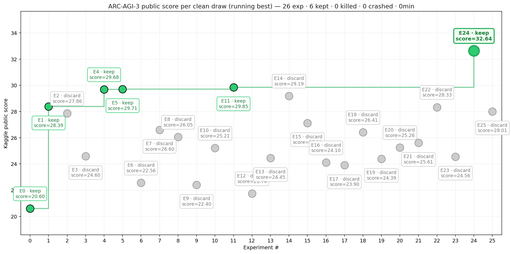

# ARC-AGI-3 final results (2026-10-14 to 2026-11-02)

The last three weeks of the ARC Prize 2026 ARC-AGI-3 Kaggle entry, after the
[phase 1 report](../report.pdf). Every number is a Kaggle public score on about 55 of the 110 hidden games; the
private score is withheld until after the close. All draws are in
[`arc-agi3-ledger.json`](arc-agi3-ledger.json).

## Result

| | |
|---|---|
| Final picks | **57854829**, v8 solved-level memory, **32.64** · **57160703**, D' v1, **29.85** |
| Public rank at the close | 296 of 5,070 (silver line 32.96, bronze 31.62, leader 75.56) |
| Lift that held | solved-level memory: 32.64, 28.01 (mean 30.33) vs 25.53 for the same kernel without it (n=5) |
| Fix that held | keep-alive: 0.00 on 10-21 to 10-23, then 9 of 9 draws scored |

Each point is one clean draw in submission order. Green points raised the running best. The six draws that failed in the
scored rerun are left out.

## Draws

| Kernel | Change | Draws | Mean | Verdict |
|---|---|---|---|---|
| plain dfranzen | none | 28.39, 27.86, 24.60, 25.21, 21.74 | 25.56 | BASELINE |
| D' v1 | slot priority (shiiin9) | 29.68, 29.71, 26.60, 22.40, 29.85, 24.45, 29.19, 27.11 | 27.37 | KEEP, final pick |
| v5 | D' + 256 px images + retrained MTP drafter | 24.10 | 24.10 | DISCARD |
| v6 | D' + [keep-alive](../../sia-oss/bench/dfz/kernel_cells/keepalive.py) | 23.90, 25.26, 25.61, 28.33, 24.56 | 25.53 | PROMOTE (fix) |
| v7 | v6 + [turn archive](../../sia-oss/bench/dfz/kernel_cells/turn_archive.py) | 26.41, 24.39 | 25.40 | DISCARD |
| v8 | v6 + [solved-level memory](../../sia-oss/bench/dfz/kernel_cells/solved_level_memory.py) | **32.64**, 28.01 | **30.33** | PROMOTE, final pick |

Failed in the scored rerun, counted but not scored: 10-17 plain (our own GPU run overlapping it), 10-21 and 10-23 D' v1,
10-22 v5 (all 0.00), 10-24 v5 (ERROR).

## What each change did

**Keep-alive (v6).** From 10-20 the scored machines took 35-63 minutes to load weights. Kaggle closes a scorecard after
15 minutes without an action, and dfranzen's one warm-up RESET plus a 15-minute first-request grace only covers loads
under about 27 minutes. The cell RESETs one live game whenever no action has gone out for 5 minutes while the server
loads, or for 10 minutes after it is up. Every draw after it scored. v6 averages 25.53 against D' v1's 27.37, a gap
inside the noise.

**Turn archive (v7).** This made the model's own trimmed turns searchable from the Python tool (`search_turns()`),
retrieval only. Its two draws averaged 25.40, under the gate set before submitting (two-draw mean ≤ 27 drops it).

**Solved-level memory (v8).** This cell is taken from
[vickyfym/arc-agi-3-lalalia-final](https://www.kaggle.com/code/vickyfym/arc-agi-3-lalalia-final) (31.46 public), which
adapted it from rellik13/sirikilohit's M85 write-up (CC-BY 4.0).

- When a level clears, the next two turn prompts ask the model for one `Rule for level N:` line.
- The rule, the winning attempt's last 30 actions and the clearing turn's reasoning are pinned at the end of the
  system prompt.
- The block is rewritten only when dfranzen's history drains from 118K to about 59K tokens. The server re-reads the
  conversation at that point anyway, so the prompt cache survives.

The cell runs unchanged apart from formatting; the pod copy's sha1 is `82120b90dc`.

## Gates, and the one we overrode

v8's save run (one practice game, ft09) completed and cleared 3 of 6 levels. The model wrote four rules and the cell
logged no errors. But the gate set beforehand required at least one `SOLVED_LEVEL_MEMORY pinned` line, and pinning only
happens on a drain, which a 45K-token run never reaches. The gate measured run length, not the cell. The automatic
fallback re-pushed v6 as v9, and we then gave v8 the last two slots by hand. That override was made after seeing the
failure, so the two public draws are the only test of v8 that was not chosen after the fact.

## Closed without a submission

| Idea | Why |
|---|---|
| Pennyroyal 3.1.2 serving bundle | The third-party bundle ships torch 2.15 against a lock pinning 2.13, lacks the SM120 JIT wheels, and versions sglang 0.0.0. |
| Longer context, more mamba slots, NVFP4 KV | Run logs show p99 context 117K of 136K, mamba use 0.67, and KV ≥ 95% on a few lines. Capacity is not binding. |
| 12 streams / prompt compaction | lalalia's notebook reports both cost 7-8 points on the hidden games. |

## Not established

- **Whether solved-level memory is a real gain.** Against v6 it is Welch t 1.97 with n=2, and 28.01 sits inside v6's range.
- **The private score**, until Kaggle publishes it.
- **Whether D' beats plain dfranzen**: 27.37 (n=8) against 25.56 (n=5).
- **What the top teams do.** The top three (75.56, 70.24, 60.95) have not published code.
